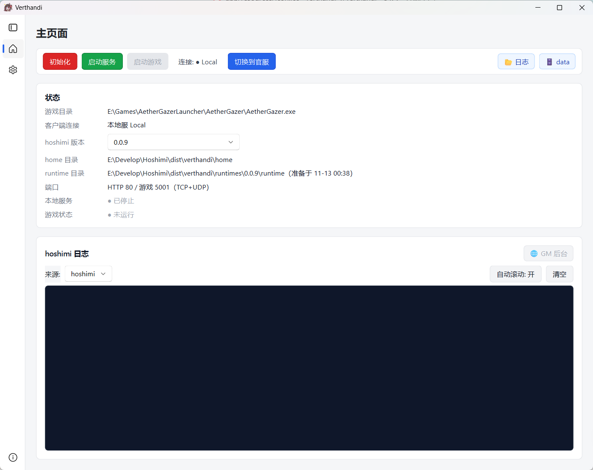
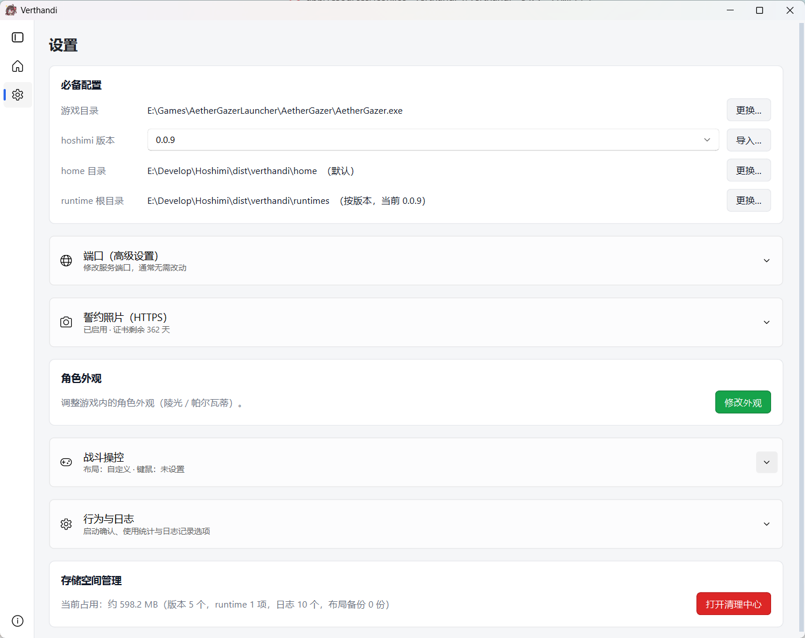
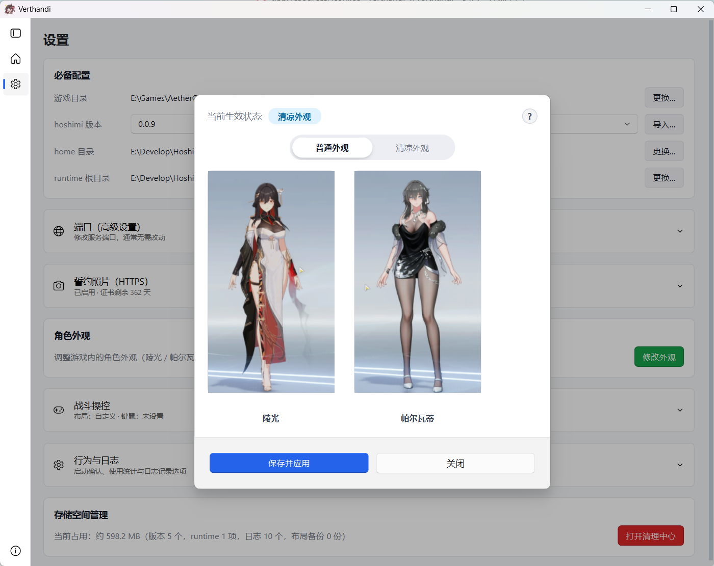
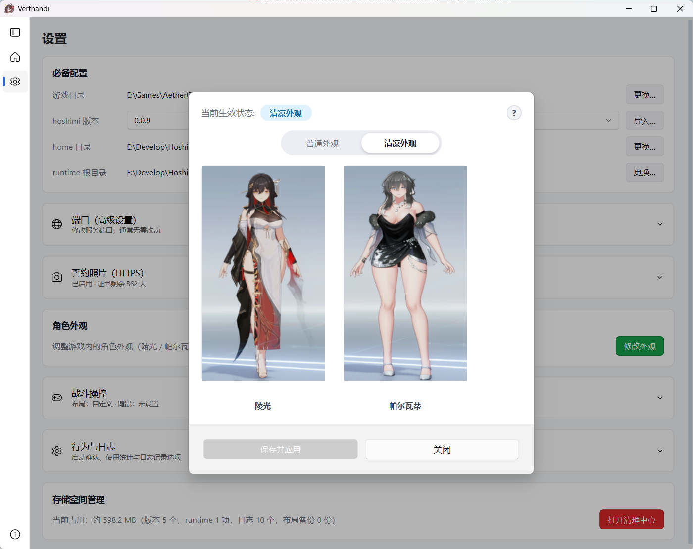
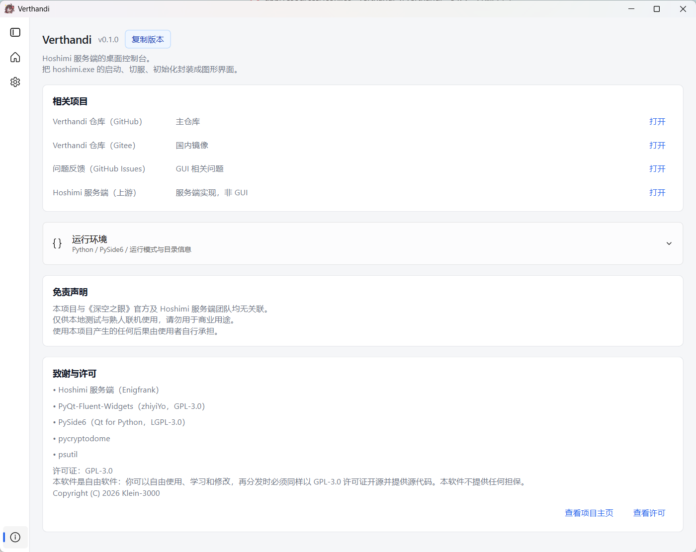

# Verthandi (薇儿丹蒂)

> Hoshimi 服务端的现代化桌面控制台。

Verthandi 是一个为 [Hoshimi](https://github.com/Enigfrank/Hoshimi) 量身定制的图形界面（GUI）。它彻底告别了命令行，让你只需鼠标点击，就能完成 hoshimi.exe 的启动、初始化、客户端切服以及角色外观修改。

## ✨ 核心特性

- **🚀 图形化启停**：一键启动/停止 Hoshimi 服务端，支持优雅退出的三级停止策略。
- **🔄 一键切服**：内置纯 Python 实现的切服逻辑（无需安装 PowerShell），安全修改 `url.txt` 和 SDK 配置。
- **🛡️ 安全初始化**：初始化先写入临时目录，完成后整体替换；失败或取消不会影响现有运行文件。
- **🌂 角色外观切换**：图形化预览并修改游戏内特定角色的外观（普通/清凉）。
- **🧹 空间管理**：可视化清理废弃的 hoshimi 版本、各版本 runtime 和庞大日志。
- **🔒 单实例运行**：重复双击不会多开，而是将已运行的窗口拉到最前。
- **📦 完全便携化**：无需安装，解压即用，所有配置和存档跟随 exe 所在目录。
- **📶 Hoshimi 0.0.8 适配**：首次启动的使用统计询问转达为弹窗（默认拒绝，由你决定），日志开关可控。

---

## 🖼️ 程序预览

### 主页面


### 设置页面


#### "清凉" 外观切换



> **💡 注意**
> 并非所有角色都有“清凉”开关（例如**陵光**没有，**帕尔瓦蒂**有）。修改后需重启游戏生效。

### 关于页面


---

## 🚀 快速开始（普通用户）

1. **下载与解压**：下载 `Verthandi-vX.X.X.zip`，解压到任意非中文路径下（如 `D:\Verthandi`）。
2. **准备 Hoshimi**：
   前往 Hoshimi 的 GitHub Releases 页面下载对应版本的压缩包（如 `Hoshimi-windows-amd64-v0.0.5.zip`）。**无需手动解压！**
   打开 Verthandi 的“设置”页面，点击 `hoshimi 版本` 右侧的 **「导入…」** 按钮，直接选择刚刚下载的 `.zip` 文件即可。Verthandi 会自动为你提取文件、校验版本并完成配置。
3. **准备游戏客户端**：确保电脑上安装了《深空之眼》PC 版。
4. **运行程序**：双击 `Verthandi.exe`。
5. **初次配置**：
   - 到“设置”页面选择你的 `AetherGazer.exe`。
   - 到主页面点击 「初始化」提取运行文件。
   - 点击「切换到本地服」
   - 点击「启动服务」。
   - 最后点击「启动游戏」。

---

## 📂 目录结构说明

Verthandi 采用 Portable（便携式）设计，核心文件如下：

```text
Verthandi/
├── Verthandi.exe          # 主程序
├── settings.json          # 配置文件
├── bin/                   # 存放 hoshimi.exe 的版本目录
│   └── <版本号>/          # 如 0.0.5
├── runtimes/              # runtime 按版本存放：runtimes/<版本号>/runtime
│   └── 0.0.5/             # prepare.json 记录该份运行文件的来源与时间
├── home/                  # 游戏存档与配置文件（由 hoshimi 生成）
├── logs/                  # 运行日志
│   ├── session-*.log      # Verthandi 自身的会话日志（默认关闭）
│   └── hoshimi/<版本>/    # hoshimi 服务日志（默认关闭，见下文）
└── _internal/             # 运行库（请勿移动或删除）
```

runtime 目录由 hoshimi 版本自动派生：切换 hoshimi 版本即切换对应 runtime，
旧版本的运行文件原地保留、随时切回，无需任何移动或复制。
若曾在旧版本中使用自定义 runtime 路径，首次启动会自动把它迁入
`runtimes/<版本>/runtime`；迁移失败时数据原地保留，重新「初始化」即可。

### 🎨 自定义图标

程序窗口图标按以下顺序查找，任何一步失败都会自动降级到下一步（不会报错）：

1. `Verthandi.exe` 同目录下的 `verthandi.ico` —— **用户自定义**，替换此文件即可换图标；
2. `_internal/app/resources/icon.ico` —— 随程序分发的内置图标；
3. 都没有时使用系统默认图标。

`verthandi.ico` 修改后**下次启动生效**，无需重新打包。

### 📝 两个日志开关的区别

设置页「行为」里有两个独立的日志开关，写日志的**主体**不同：

| 开关 | 谁在写 | 内容 | 位置 |
|---|---|---|---|
| 记录日志到文件（logs/session-\*.log） | Verthandi 自身 | GUI 操作记录、切服日志、hoshimi 控制台输出的转写 | `logs/session-*.log` |
| 记录 Hoshimi 服务日志 | hoshimi.exe | hoshimi 的内部运行日志（诊断细节比控制台输出更全） | `logs/hoshimi/<版本>/` |

- 「记录 Hoshimi 服务日志」默认**关闭**：关闭时 Verthandi 向 hoshimi 传 `--no-log`，完全不写日志文件；开启时每次启动在 `logs/hoshimi/<版本>/` 下生成一个文件，可在清理页查看体积并删除。
- 排查「服务起不来 / 游戏连不上」时，Hoshimi 服务日志通常比会话日志更有用。
- hoshimi 0.0.5 及更早版本不支持日志参数，Verthandi 会自动探测并保持该版本的默认行为（日志出现在 `bin/<版本>/logs/`）。

### 📶 Hoshimi 0.0.8 的使用统计询问

hoshimi 0.0.8 起首次启动会询问是否启用它自己的「使用统计」（遥测，数据发送至第三方 Umami Cloud），并阻塞等待作答。由于 Verthandi 隐藏了 hoshimi 的控制台，这个问题改由 **Verthandi 在启动服务前弹窗转达**——**这是 Hoshimi（第三方服务端程序）自身的功能，与 Verthandi 无关**，默认「保持关闭」。

- 选择会直接写入 `home/config.json`（`telemetry_enabled`，开启时还会写 `telemetry_consent`），hoshimi 见键即不再询问，因此不会卡在启动阶段；
- 弹窗里可以勾选「记住我的选择，不再询问」；不勾选就下次启动再确认一次；
- 之后随时可在设置页「行为」卡片里打开「允许 Hoshimi 发送使用统计」（开启前会再确认一次收集范围），开关从下次启动服务生效；
- 多个版本共用同一份 `home/config.json`，设一次对所有 0.0.8+ 版本生效；0.0.3 之类不带遥测的版本不受影响（开关会自动置灰）。

---

## 🛠️ 常见问题 (FAQ)
```
Q: 为什么 Windows Defender 报毒？
A: 这是 PyInstaller 打包 Python 程序的通病（误报）。程序代码完全开源，请将 Verthandi.exe 加入杀毒软件白名单。

Q: 为什么显示“未找到游戏配置文件”无法修改外观？
A: 请先启动一次游戏客户端。游戏会在 C:\Users\<用户名>\AppData\LocalLow\yongshi\AetherGazer 下生成 sys_config.ini。

Q: 打包后的程序体积较大？
A: 程序内置了完整的 Python 运行环境和 Qt 图形库，约 138MB，属于正常现象。
```
---

## 💻 开发者指南（源码运行与打包）
如果你想修改代码或自行编译：

1. 克隆仓库并安装依赖（推荐使用 uv）：
```bash
uv sync
```

2. 运行源码：
```bash
uv run verthandi.py
```

3. 打包为 EXE：
```bash
# 安装 pyinstaller 库
uv pip install pyinstaller

# 进行编译
uv run pyinstaller Verthandi.spec
```

4. 启用提交前检查（只需执行一次）：
```bash
git config core.hooksPath .githooks
```
之后每次 `git commit` 都会对暂存区里的 `.py` 执行 `ruff check` 与 `ruff format --check`，任一不通过即中止提交。手动检查用 `uv run ruff check .` 与 `uv run ruff format --check .`，格式化用 `uv run ruff format .`。
---

## 🙏 致谢与许可
本项目基于 [GPL-3.0](./LICENSE) 协议开源（因引入 [PyQt-Fluent-Widgets](https://github.com/zhiyiYo/PyQt-Fluent-Widgets) 组件库，整体许可证由 Apache-2.0 调整为 GPL-3.0）。

- 感谢 [Hoshimi](https://github.com/Enigfrank/Hoshimi) 提供强大的服务端支持。

- 感谢 [PyQt-Fluent-Widgets](https://github.com/zhiyiYo/PyQt-Fluent-Widgets)（GPL-3.0）提供 Fluent 风格界面组件。

- 感谢 PySide6, psutil, pycryptodome 等优秀的开源库。

- 免责声明：本项目与《深空之眼》官方及 Hoshimi 团队均无关联。仅供本地测试与熟人联机使用，请勿用于商业用途。
