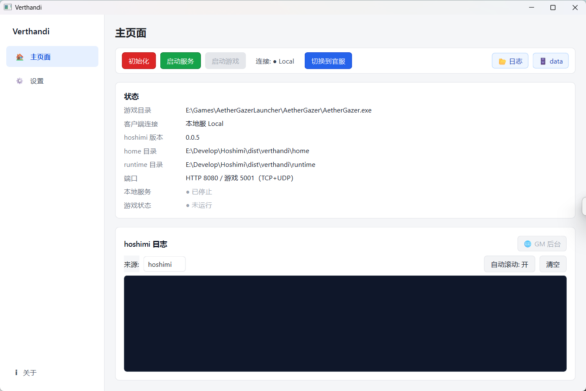
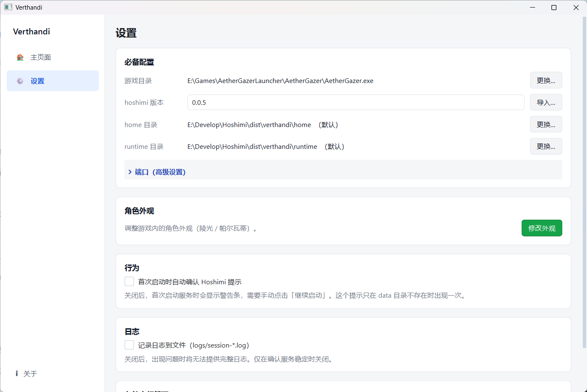
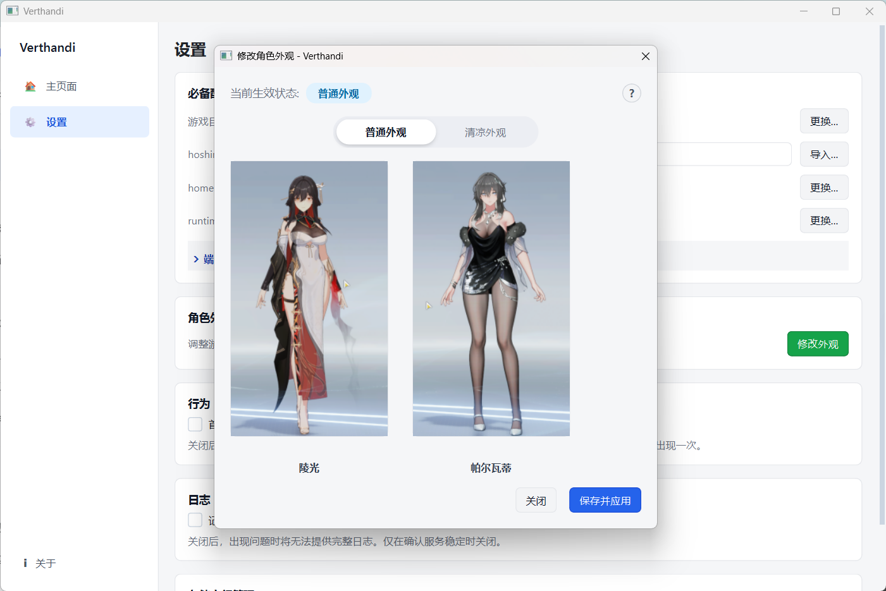
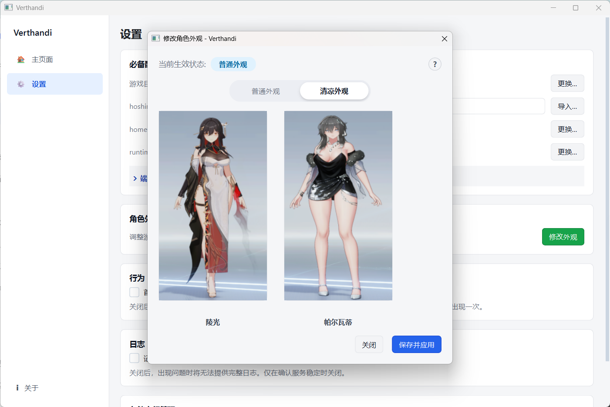
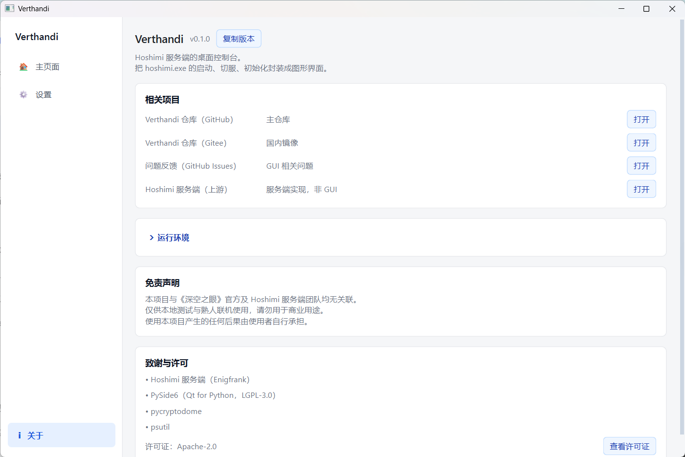

# Verthandi (星见)

> Hoshimi 服务端的现代化桌面控制台。

Verthandi 是一个为 [Hoshimi](https://github.com/Enigfrank/Hoshimi) 量身定制的图形界面（GUI）。它彻底告别了命令行，让你只需鼠标点击，就能完成 hoshimi.exe 的启动、初始化、客户端切服以及角色外观修改。

## ✨ 核心特性

- **🚀 图形化启停**：一键启动/停止 Hoshimi 服务端，支持优雅退出的三级停止策略。
- **🔄 一键切服**：内置纯 Python 实现的切服逻辑（无需安装 PowerShell），安全修改 `url.txt` 和 SDK 配置。
- **🛡️ 安全初始化**：自动备份旧 `runtime`，版本冲突时支持回滚。
- **🌂 角色外观切换**：图形化预览并修改游戏内特定角色的外观（普通/清凉）。
- **🧹 空间管理**：可视化清理废弃的 hoshimi 版本、备份和庞大日志。
- **🔒 单实例运行**：重复双击不会多开，而是将已运行的窗口拉到最前。
- **📦 完全便携化**：无需安装，解压即用，所有配置和存档跟随 exe 所在目录。

---

## 🖼️ 程序预览

### 主页面


### 设置页面


#### "清凉" 外观切换



> **💡 注意**
> 并非所有角色都有“清凉”开关（例如**陵光**没有，**帕尔瓦蒂**有）。修改后需重启游戏生效。

### 关于页面


---

## 🚀 快速开始（普通用户）

1. **下载与解压**：下载 `Verthandi-vX.X.X.zip`，解压到任意非中文路径下（如 `D:\Verthandi`）。
2. **准备 Hoshimi**：
   前往 Hoshimi 的 GitHub Releases 页面下载对应版本的压缩包（如 `Hoshimi-windows-amd64-v0.0.5.zip`）。**无需手动解压！**
   打开 Verthandi 的“设置”页面，点击 `hoshimi 版本` 右侧的 **「导入…」** 按钮，直接选择刚刚下载的 `.zip` 文件即可。Verthandi 会自动为你提取文件、校验版本并完成配置。
3. **准备游戏客户端**：确保电脑上安装了《深空之眼》PC 版。
4. **运行程序**：双击 `Verthandi.exe`。
5. **初次配置**：
   - 到“设置”页面选择你的 `AetherGazer.exe`。
   - 到主页面点击 「初始化」提取运行文件。
   - 点击「切换到本地服」
   - 点击「启动服务」。
   - 最后点击「启动游戏」。

---

## 📂 目录结构说明

Verthandi 采用 Portable（便携式）设计，核心文件如下：

```text
Verthandi/
├── Verthandi.exe          # 主程序
├── settings.json          # 配置文件
├── bin/                   # 存放 hoshimi.exe 的版本目录
│   └── <版本号>/          # 如 0.0.5
├── home/                  # 游戏存档与配置文件（由 hoshimi 生成）
├── runtime/               # 游戏运行提取文件（由初始化生成）
├── backup/                # runtime 自动备份目录
├── logs/                  # 运行日志
└── _internal/             # 运行库（请勿移动或删除）
```

---

## 🛠️ 常见问题 (FAQ)
```
Q: 为什么 Windows Defender 报毒？
A: 这是 PyInstaller 打包 Python 程序的通病（误报）。程序代码完全开源，请将 Verthandi.exe 加入杀毒软件白名单。

Q: 为什么显示“未找到游戏配置文件”无法修改外观？
A: 请先启动一次游戏客户端。游戏会在 C:\Users\<用户名>\AppData\LocalLow\yongshi\AetherGazer 下生成 sys_config.ini。

Q: 打包后的程序体积较大？
A: 程序内置了完整的 Python 运行环境和 Qt 图形库，约 138MB，属于正常现象。
```
---

## 💻 开发者指南（源码运行与打包）
如果你想修改代码或自行编译：

1. 克隆仓库并安装依赖（推荐使用 uv）：
```bash
uv sync
```

2. 运行源码：
```bash
uv run verthandi.py
```

3. 打包为 EXE：
```bash
# 安装 pyinstaller 库
uv pip install pyinstaller

# 进行编译
uv run pyinstaller verthandi.spec
```
---

## 🙏 致谢与许可
本项目基于 [Apache-2.0](./LICENSE) 协议开源。

- 感谢 [Hoshimi](https://github.com/Enigfrank/Hoshimi) 提供强大的服务端支持。

- 感谢 PySide6, psutil, pycryptodome 等优秀的开源库。

- 免责声明：本项目与《深空之眼》官方及 Hoshimi 团队均无关联。仅供本地测试与熟人联机使用，请勿用于商业用途。
